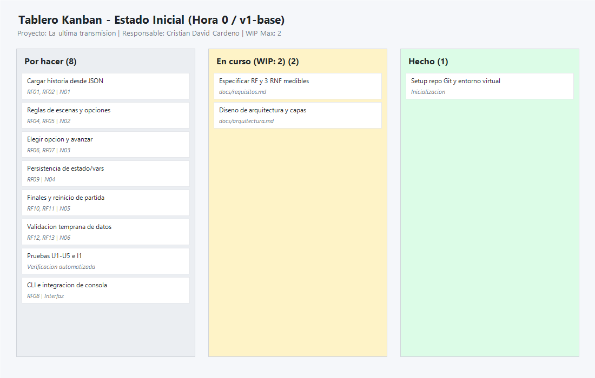
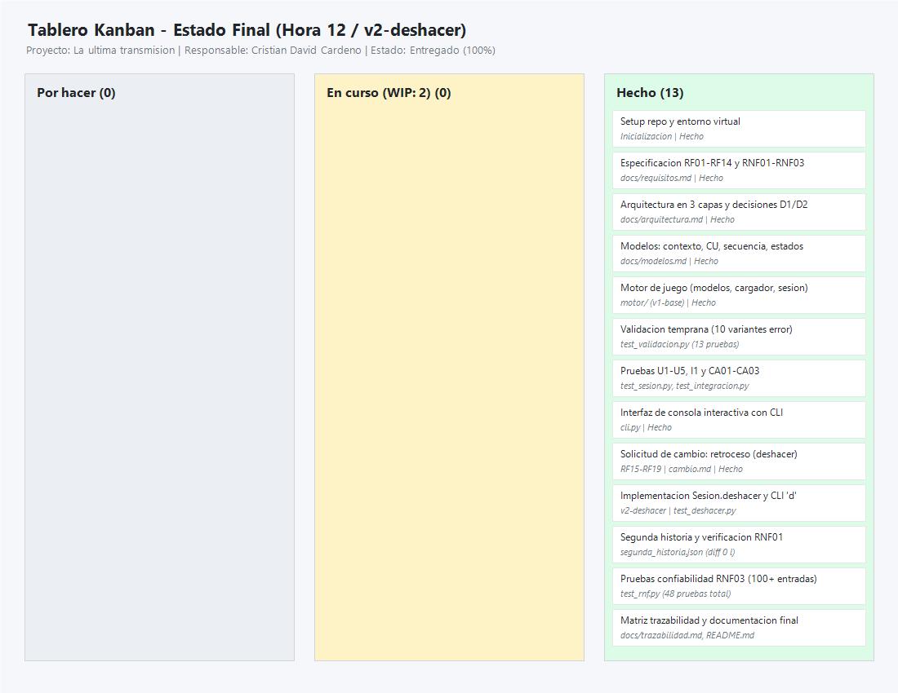
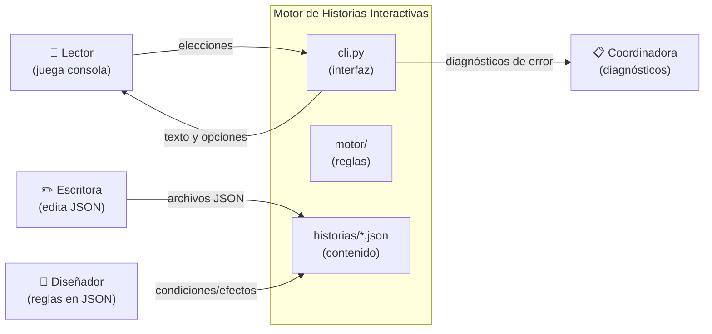
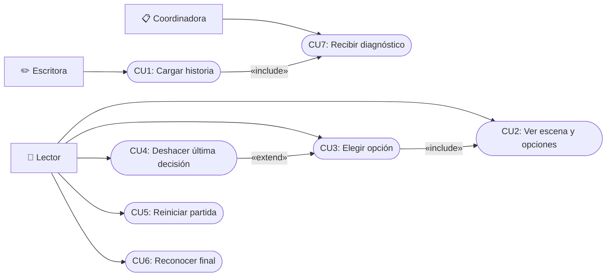
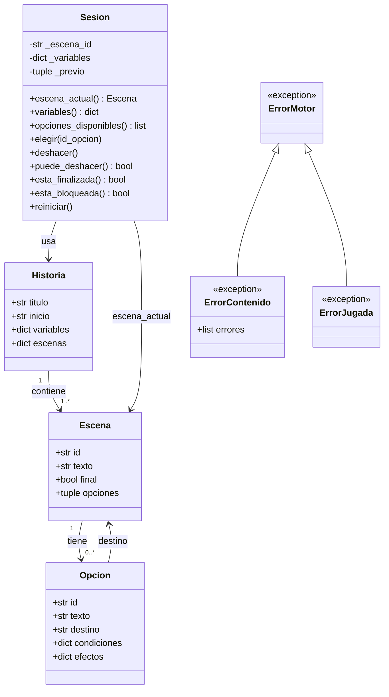
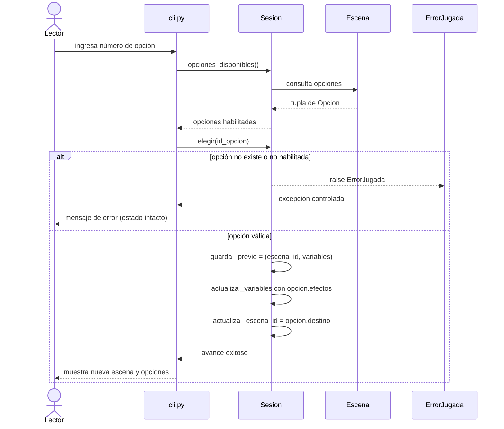
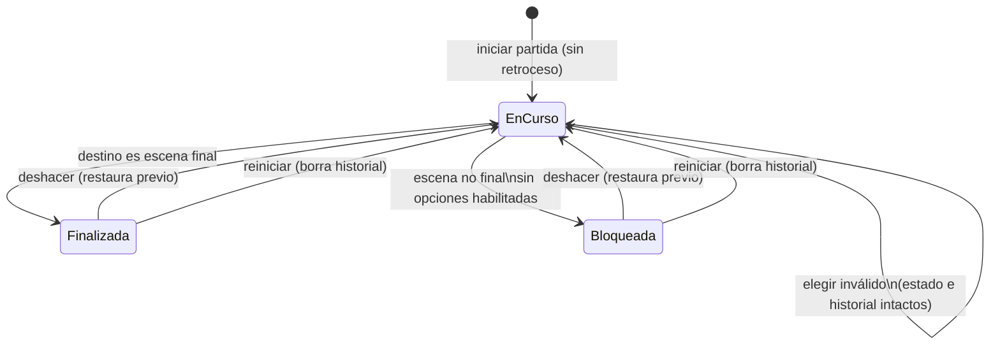

# Anexo Técnico – Parcial Práctico de Ingeniería de Software
## Proyecto: *La última transmisión*

**Estudiante:** Cristian David Cardeño Gulloso  
**Documento complementario al Informe Final**

---

## 1. Evidencia del Proceso y Tablero Kanban

### 1.1. Tablero Inicial (Hora 0 / Etiqueta Git: `v1-base`)

*Descripción:* Captura del estado al inicio del proyecto. Tareas identificadas a partir de las necesidades N01 a N06, con límite de trabajo en curso (WIP = 2).

### 1.2. Tablero Final (Hora 12 / Etiqueta Git: `v2-deshacer`)

*Descripción:* Estado de cierre con la totalidad de tarjetas completadas en la columna "Hecho", incluyendo las tareas derivadas de la solicitud de cambio de la hora 6.

---

## 2. Diagramas del Sistema (Modelado del Dominio)

### 2.1. Diagrama de Contexto

### 2.2. Diagrama de Casos de Uso

### 2.3. Diagrama de Clases del Dominio

### 2.4. Diagrama de Secuencia: Elegir una Opción

### 2.5. Diagrama de Estados de Sesión

---

## 3. Matriz Completa de Trazabilidad

| ID | Necesidad | Modelo | Archivo / Componente | Prueba Automatizada | Estado |
|---|---|---|---|---|---|
| RF01 | N01 | CU1, Clases | `motor/cargador.py` | `test_integracion.py::test_i1_archivo_real_hasta_un_final` | Cumple |
| RF02 | N01 | Clases | `motor/sesion.py` | `test_sesion.py::test_u5_reiniciar_restaura_estado_inicial` | Cumple |
| RF03 | N01 | Contexto | `historias/segunda_historia.json` | `test_segunda_historia.py` (4 pruebas) | Cumple |
| RF04 | N02 | CU2, Secuencia | `cli.py` | `test_integracion.py` | Cumple |
| RF05 | N02 | CU2, Clases | `motor/sesion.py` | `test_sesion.py::test_u1_condiciones_habilitan_solo_las_correspondientes` | Cumple |
| RF06 | N03 | CU3, Secuencia | `motor/sesion.py` | `test_sesion.py::test_u2_eleccion_valida_aplica_efectos_y_avanza` | Cumple |
| RF07 | N03 | Secuencia | `motor/sesion.py` | `test_sesion.py::test_u3_opcion_invalida_deja_estado_intacto` | Cumple |
| RF08 | N03 | CU3, Secuencia | `cli.py` | `test_rnf.py::test_rnf03_mas_de_100_entradas_invalidas_no_producen_excepciones_no_controladas` | Cumple |
| RF09 | N04 | Clases | `motor/sesion.py` | `test_integracion.py` (CA01) | Cumple |
| RF10 | N05 | CU6, Estados | `motor/sesion.py`, `cli.py` | `test_sesion.py::test_final_se_reconoce` | Cumple |
| RF11 | N05 | CU5, Estados | `motor/sesion.py` | `test_sesion.py::test_u5_reiniciar_restaura_estado_inicial` | Cumple |
| RF12 | N06 | CU7, Clases | `motor/cargador.py` | `test_validacion.py` (10 variantes de contenido) | Cumple |
| RF13 | N06 | CU7 | `motor/cargador.py` | `test_validacion.py` (aserciones de ID y causa) | Cumple |
| RF14 | N06, N03 | Estados | `motor/sesion.py`, `cli.py` | `test_sesion.py::test_bloqueo_en_escena_no_final_sin_opciones_habilitadas` | Cumple |
| RF15 | Cambio H6 | CU4, Estados | `motor/sesion.py` | `test_deshacer.py::test_u6_deshacer_restaura_escena_y_variables_y_consume_retroceso` | Cumple |
| RF16 | Cambio H6 | Estados | `motor/sesion.py` | `test_deshacer.py::test_u6_deshacer_solo_revierte_la_ultima_eleccion` | Cumple |
| RF17 | Cambio H6 | Estados | `motor/sesion.py` | `test_deshacer.py::test_u6_no_hay_retroceso_al_iniciar` | Cumple |
| RF18 | Cambio H6 | Secuencia | `motor/sesion.py` | `test_deshacer.py::test_u6_entrada_invalida_preserva_el_historial` | Cumple |
| RF19 | Cambio H6 | Estados | `motor/sesion.py` | `test_deshacer.py::test_u6_deshacer_desde_un_final` | Cumple |
| RNF01 | Calidad | Arquitectura | `historias/segunda_historia.json` | `docs/evidencia_rnf01.txt`, `test_segunda_historia.py` | Cumple |
| RNF02 | Calidad | Cargador | `motor/cargador.py` | `test_validacion.py` (10 casos parametrizados) | Cumple |
| RNF03 | Calidad | Robustez | `motor/sesion.py`, `cargador.py` | `test_rnf.py` (11 pruebas parametrizadas) | Cumple |

---

## 4. Guion Sugerido para la Demostración en Video (MP4)

Duración máxima: 6 minutos.

1. **Introducción y Carga de la Historia (1:00 min):**
   - Ejecutar `python cli.py` cargando `historias/la_ultima_transmision.json`.
   - Mostrar la escena E1 y explicar las opciones iniciales.
2. **Recorrido de los Tres Finales (2:00 min):**
   - **Final E4 (Rescate):** E1 → Revisar señal → E2 → Investigar archivo → E3 → Activar con código → E4 (FIN).
   - Usar `r` para reiniciar.
   - **Final E5 (El eco):** E1 → Revisar señal → E2 → Continuar sin investigar → E3 → Activar sin verificar → E5 (FIN).
   - Usar `r` para reiniciar.
   - **Final E6 (Silencio):** E1 → Revisar señal → E2 → E3 → Cortar comunicación → E6 (FIN).
3. **Demostración de la Función Deshacer (Cambio Hora 6) (1:00 min):**
   - Desde E2, elegir "Investigar archivo" hacia E3.
   - Ingresar comando `d`: demostrar el retorno a E2 y restauración de `conoce_origen = false`.
   - Ingresar `d` nuevamente: mostrar mensaje de error de un solo nivel de retroceso.
4. **Segunda Historia y Diagnóstico de Error (1:00 min):**
   - Ejecutar `python cli.py historias/segunda_historia.json` y demostrar navegación con el mismo motor.
   - Provocar un error de validación (por ejemplo, con un archivo corrupto o destino inexistente) mostrando el mensaje con ID y causa.
5. **Ejecución de Pruebas y Cierre (1:00 min):**
   - Correr `python -m pytest -v` mostrando 48 pruebas en verde.
   - Mencionar la decisión arquitectónica en capas (D1) y la inmutabilidad de los datos.
