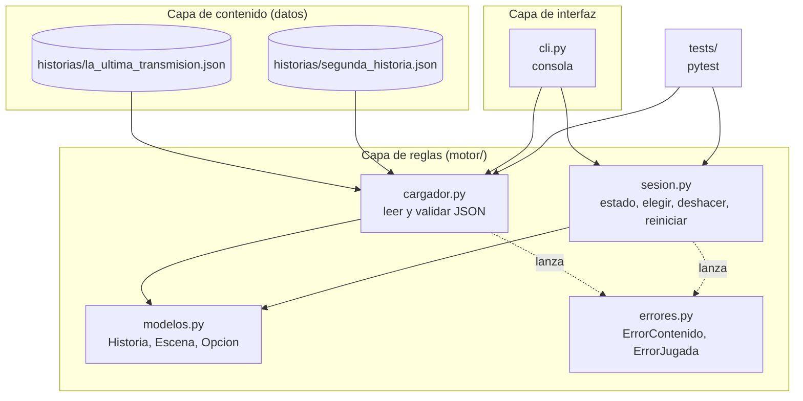

# Arquitectura – La última transmisión (v2)

## 1. Diagrama de componentes

La dependencia va en una sola dirección: **interfaz → motor → modelos**. El motor no importa nada de `cli.py`, y el contenido no contiene código.

## 2. Responsabilidades

| Componente | Responsabilidad | No hace |
|---|---|---|
| `historias/*.json` | Definen escenas, opciones, condiciones, efectos y estado inicial | No contienen lógica |
| `motor/cargador.py` | Lee el archivo, valida el contenido (10 variantes de error) y construye la `Historia` | No juega ni imprime |
| `motor/modelos.py` | Estructuras de datos inmutables del dominio | No tienen comportamiento de partida |
| `motor/sesion.py` | Estado de la partida: opciones habilitadas, elegir, deshacer, reiniciar, finales y bloqueo | No lee archivos ni interactúa con el usuario |
| `motor/errores.py` | Excepciones propias que distinguen contenido inválido de jugada inválida | – |
| `cli.py` | Entrada y salida por consola; traduce errores del motor a mensajes | No contiene reglas del relato |
| `tests/` | Verificación automatizada de reglas, validación e integración | – |

## 3. Decisiones de arquitectura

### D1. Historias dirigidas por datos (JSON) en lugar de codificadas en el programa

- **Contexto:** la escritora quiere editar escenas y decisiones sin pedir cambios al programa. El cliente también quiere cargar otras historias.
- **Alternativas:** (a) escenas y reglas escritas en el código; (b) un archivo de datos interpretado por un motor genérico.
- **Elección:** (b), con JSON y el contrato de la guía.
- **Consecuencias:**
  - (+) Agregar o editar una historia no modifica el código (RNF01).
  - (+) El motor no tiene condicionales específicos de E1, E2 u otras escenas.
  - (−) Hay que validar el archivo, porque ya no lo revisa el compilador.
  - (−) Las reglas se limitan a igualdades booleanas, lo cual es suficiente para el alcance.

### D2. Validar todo el contenido al cargar (falla temprana) en lugar de al jugar

- **Contexto:** la coordinadora necesita saber qué corregir y el lector no debe ver cierres inesperados.
- **Alternativas:** (a) validar cada dato cuando se usa durante la partida; (b) validar el archivo completo antes de crear la sesión.
- **Elección:** (b). El cargador devuelve **todos** los errores a la vez y no se abre sesión jugable si hay alguno.
- **Consecuencias:**
  - (+) El escritor recibe la lista completa de problemas con causa e ID (RNF02).
  - (+) La sesión puede asumir que el contenido es coherente, lo que simplifica `Sesion`.
  - (−) No se detectan todos los callejones sin salida posibles; por eso la sesión informa el bloqueo si ocurre.

## 4. Separación entre contenido, reglas e interfaz

**Justificación.** Cada capa cambia por motivos distintos: el contenido lo cambian los escritores, las reglas las cambia el equipo de software y la interfaz depende de dónde se juegue (consola hoy, web mañana). Separarlas evita que un cambio de una capa obligue a tocar las otras.

**Demostración con la segunda historia.**

1. `historias/segunda_historia.json` ("El faro apagado") tiene otras escenas (F1–F4) y otra variable (`tiene_luz`).
2. Se carga con el mismo motor y la misma consola: `python cli.py historias/segunda_historia.json`.
3. La prueba `tests/test_segunda_historia.py` comprueba que una condición cambia las opciones y que `deshacer` funciona.
4. `docs/evidencia_rnf01.txt` contiene la salida de `git diff --stat v2-deshacer HEAD -- motor cli.py` y está vacía: agregar la segunda historia no modificó el motor ni la interfaz.

**Demostración con el cambio de la hora 6.** El retroceso se resolvió únicamente en `motor/sesion.py` y en el comando `d` de `cli.py`. Cargador, modelos, errores y archivos de historia no cambiaron (ver `docs/cambio.md`).

## 5. Decisión de diseño detallado: responsabilidades y acoplamiento

- `Sesion` solo depende de `Historia` y de `ErrorJugada`. No imprime ni lee entrada, así que se prueba sin consola.
- Los modelos son `dataclass` inmutables (`frozen=True`): la sesión no puede alterar el contenido cargado por accidente.
- `Sesion.variables` devuelve una copia, de modo que el exterior no puede modificar el estado sin pasar por `elegir`, `deshacer` o `reiniciar`.
- El estado se modifica solo después de validar la elección, lo que garantiza que una entrada inválida deje la sesión intacta (RF07, RF18).

## 6. Bibliotecas y licencias

| Biblioteca | Uso | Licencia |
|---|---|---|
| `json` (biblioteca estándar de Python) | Leer archivos de historia | Python Software Foundation License |
| `pytest` | Ejecutar las pruebas automatizadas | MIT |
