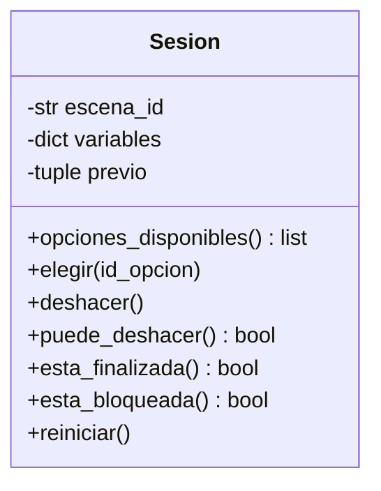
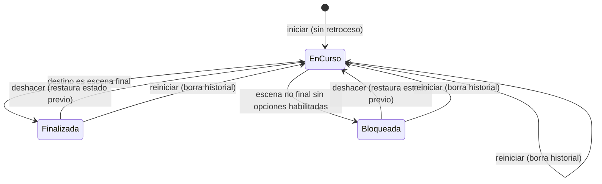

# Gestión del cambio – Deshacer la última decisión

**Versión de partida:** etiqueta `v1-pre-cambio` (motor sin retroceso, JSON oficial, 23 pruebas pasan).
**Versión posterior:** etiqueta `v2-deshacer`.
**Origen:** Solicitud de cambio publicada en la hora 6. Reemplaza el acuerdo provisional de no implementar retroceso (requisitos, sección 5).

## 1. Nuevos requisitos

| ID | Requisito | Criterio de aceptación |
|---|---|---|
| RF15 | El lector puede deshacer su última elección válida. Se restauran exactamente la escena y todas las variables anteriores a esa elección. | Desde E2, investigar lleva a E3 con `conoce_origen` verdadero. Deshacer devuelve a E2 con `conoce_origen` falso. |
| RF16 | El retroceso es de un solo nivel: tras deshacer no se puede volver a deshacer hasta realizar una nueva elección válida. | Un segundo intento de deshacer no cambia la sesión. Tras elegir de nuevo, deshacer vuelve a estar disponible. |
| RF17 | Al comenzar una partida no hay retroceso disponible. Reiniciar elimina el historial y restaura el estado inicial. | En una partida nueva deshacer no cambia nada. Tras elegir y reiniciar, deshacer no cambia nada. |
| RF18 | Una opción inexistente o no habilitada no modifica la sesión ni sustituye el historial de la última elección válida. | Tras una elección inválida, deshacer sigue restaurando el estado anterior a la última elección **válida**. |
| RF19 | Se puede deshacer desde un final (E4, E5 o E6): se regresa a E3 y se restauran los valores previos a esa elección. | Desde E4, deshacer devuelve a E3 con `confia_en_la_voz` falso. |

Interacción con requisitos previos: RF07 (entrada inválida) se complementa con RF18, y RF11 (reiniciar) se complementa con RF17.

## 2. Análisis de impacto

| Artefacto | ¿Afectado? | Qué cambia |
|---|---|---|
| `docs/requisitos.md` | Sí | RF15–RF19; sección 5 pasa a "resuelto por el cliente"; P1 respondida; P3 actualizada (JSON oficial publicado) |
| Modelo de casos de uso | Sí | Nuevo caso de uso "Deshacer decisión" |
| Modelo de clases | Sí | `Sesion` gana `puede_deshacer()`, `deshacer()` y el atributo privado `previo` |
| Modelo de secuencia | Sí | Al elegir con éxito, la sesión guarda el estado previo antes de aplicar efectos |
| Modelo de estados | Sí | Nueva transición `deshacer`; reiniciar elimina el historial |
| `motor/sesion.py` | Sí | Instantánea del estado previo, `deshacer()` y `puede_deshacer()` |
| `cli.py` | Sí | Comando `d` (visible solo si hay retroceso), mensajes de reinicio y deshacer |
| `motor/cargador.py`, `modelos.py`, `errores.py` | No | Sin cambios: el retroceso no depende del contenido |
| `historias/*.json` | No | Sin cambios: el cambio no exige un formato nuevo |
| `tests/` | Sí | U6 nuevo; U5 e I1 extendidas (`tests/test_deshacer.py`) |
| RNF01, RNF02 | No | Sin cambio |
| RNF03 | Sí | Las entradas inválidas aleatorias también se prueban contra `deshacer()` |
| Backlog | Sí | Tarjetas nuevas: RF15–RF19, código, pruebas, actualizar modelos y trazabilidad |

## 3. Decisión de diseño

- **Contexto:** el cliente pide exactamente un nivel de retroceso, sin rehacer.
- **Alternativas:** (a) guardar una sola instantánea del estado previo, (b) guardar una pila de historial.
- **Elección:** instantánea única, porque modela directamente el requisito y es la solución más simple.
- **Consecuencias:** el costo de memoria es constante y las reglas RF16–RF18 se cumplen por construcción (la instantánea solo se escribe tras una elección validada). Si el cliente pidiera varios niveles, habría que cambiar a una pila; el cambio quedaría contenido en `Sesion`.

## 4. Modelos actualizados (fragmentos)

Nota: el caso de uso y la secuencia de elegir se actualizan en `docs/modelos.md` en la misma línea (nuevo caso "Deshacer decisión"; paso extra "guardar estado previo" antes de aplicar efectos).

## 5. Evidencia

- Registro de pruebas antes del cambio: `docs/resultados_pruebas.txt` (etiqueta `v1-base`).
- Registro de pruebas después del cambio: `docs/resultados_pruebas_v2.txt` (etiqueta `v2-deshacer`).
- Pruebas nuevas: `tests/test_deshacer.py` (U6, U5 extendida, I1 extendida).
- Recorrido manual con `python cli.py`: investigar → deshacer → continuar sin investigar.