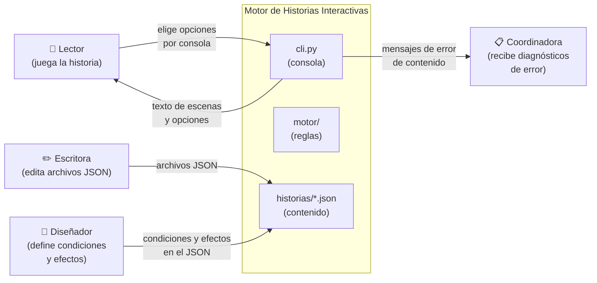
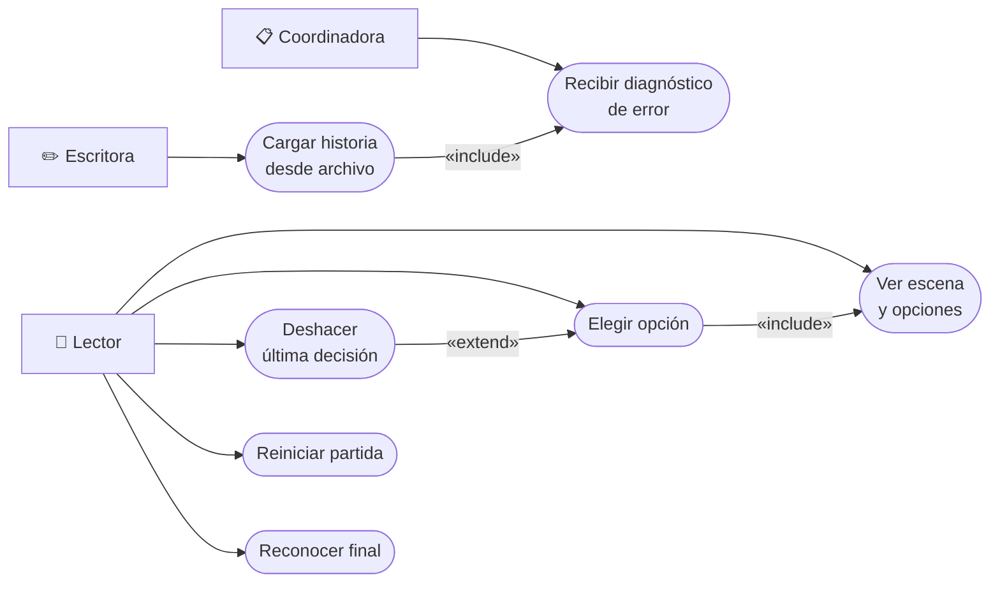
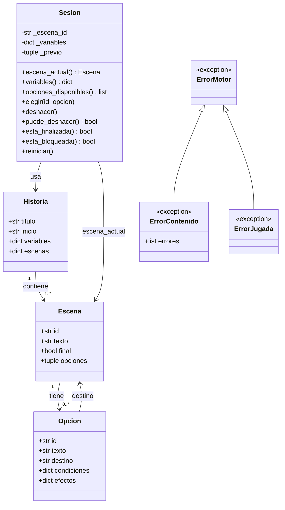
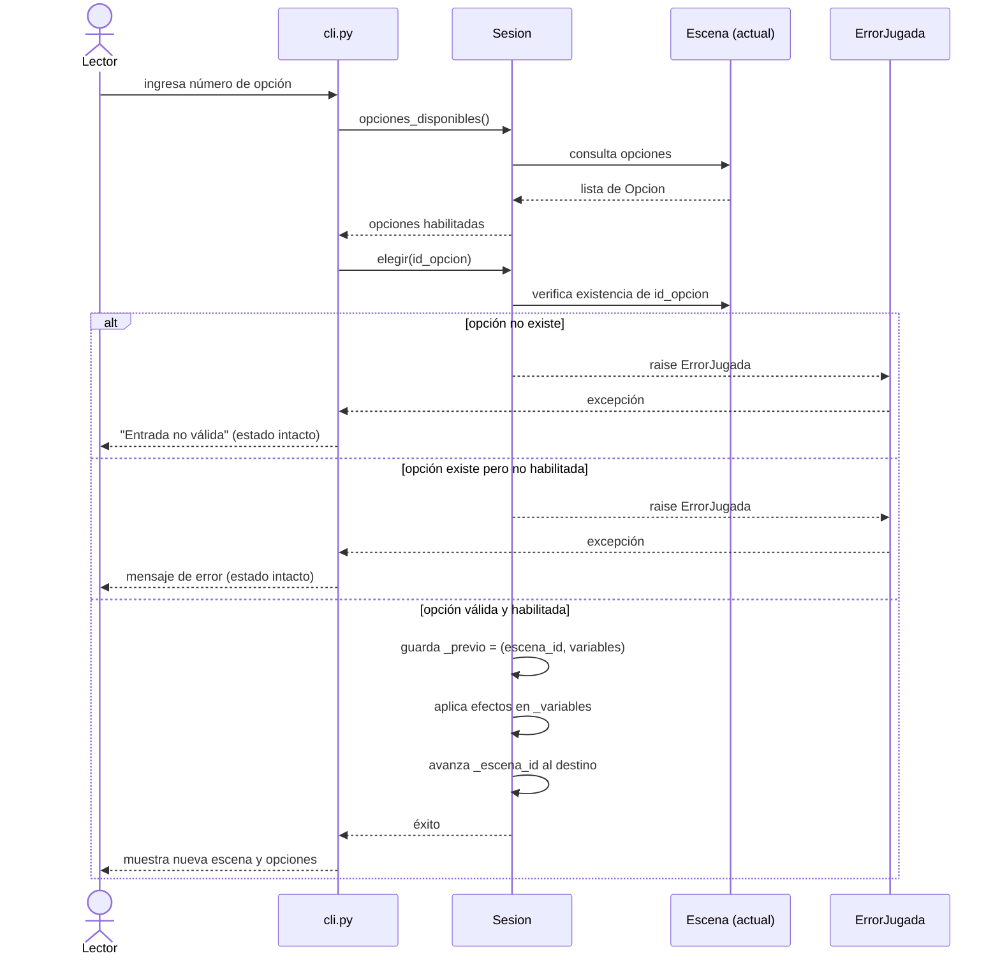
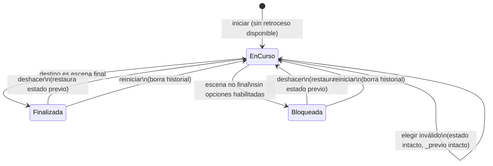

# Modelos – La última transmisión (v2)

**Integrante:** Cristian David Cardeño Gulloso

---

## 1. Diagrama de contexto

El sistema Motor de Historias Interactivas recibe un archivo de historia de la escritora y expone una interfaz de consola al lector. La coordinadora del festival también interactúa indirectamente al revisar los mensajes de error de validación.

---

## 2. Casos de uso

**Descripción de casos de uso:**

| ID | Nombre | Actor principal | Descripción breve |
|---|---|---|---|
| CU1 | Cargar historia | Escritora / Sistema | Lee el JSON, valida todos los campos y construye la Historia. Si hay errores los reporta todos y no abre sesión. |
| CU2 | Ver escena y opciones | Lector | Muestra el texto de la escena actual y solo las opciones cuyas condiciones se cumplen. |
| CU3 | Elegir opción | Lector | Valida que la opción exista y esté habilitada; aplica efectos y avanza al destino. |
| CU4 | Deshacer última decisión | Lector | Restaura la escena y variables anteriores a la última elección válida (un nivel). |
| CU5 | Reiniciar partida | Lector | Vuelve a la escena inicial con las variables originales y elimina el historial. |
| CU6 | Reconocer final | Lector | Al llegar a una escena final, muestra el texto y el mensaje "FIN de la historia". |
| CU7 | Recibir diagnóstico | Coordinadora | Cada error de validación indica causa, campo e ID involucrado. |

---

## 3. Clases del dominio

> [!NOTE]
> `Historia`, `Escena` y `Opcion` son `dataclass(frozen=True)`: inmutables. `Sesion` es la única clase con estado mutable de la partida. `ErrorContenido` acumula todos los errores encontrados en la lista `errores`.

---

## 4. Diagrama de secuencia — Elegir una opción

---

## 5. Diagrama de estados — Sesion

---

## 6. Coherencia entre modelos y requisitos

| Modelo | Requisitos que refleja |
|---|---|
| Contexto | N01–N06 (todos los actores y el sistema completo) |
| Casos de uso | RF01, RF04–RF07, RF10–RF11, RF15, RF12–RF13 |
| Clases | RF01–RF03 (Historia/Escena/Opcion), RF05–RF09 (Sesion), RF12 (ErrorContenido) |
| Secuencia de elegir | RF05–RF07, RF18 (estado intacto ante error) |
| Estados | RF10, RF11, RF14, RF15–RF17, RF19 |
